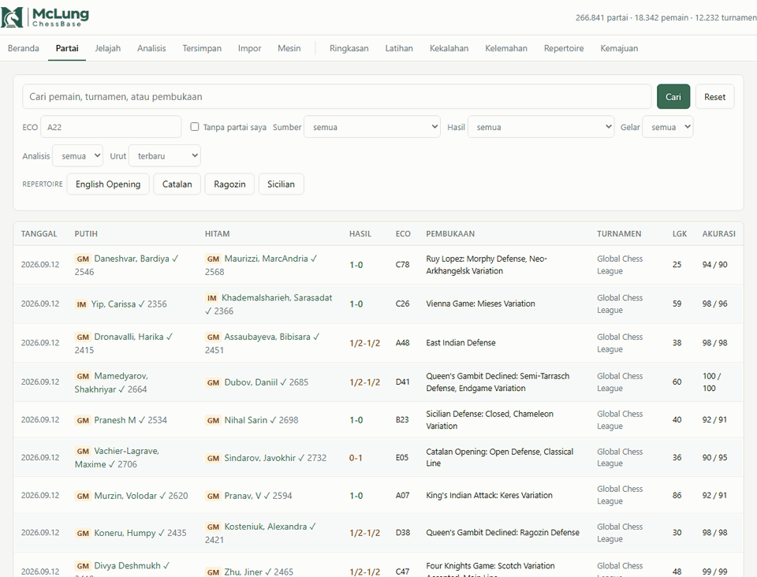

# Chess GM Database

[](https://github.com/raymclung/catur/actions/workflows/tes.yml)

> A personal chess study app: a database of grandmaster games, engine analysis
> with Stockfish, and training built from my own losses.
> Python · FastAPI · SQLite · vanilla HTML/JS. Documentation and code are in
> Bahasa Indonesia.



Aplikasi web lokal untuk belajar catur dari partai grandmaster dan dari
kekalahan sendiri. Semua partai (GM maupun pribadi) masuk satu database,
dianalisis Stockfish, lalu dipakai untuk latihan.

## Fitur

- **Database partai GM** — impor dari arsip TWIC, broadcast resmi Lichess, dan
  PGN lokal. Tiap partai menyimpan `sumber` dan `sumber_url`, jadi asal setiap
  partai selalu bisa ditelusuri. Impor aman diulang (sidik jari partai, tanpa
  duplikat).
- **Jelajah posisi & repertoire** — indeks posisi (FEN) untuk melihat langkah
  apa yang dimainkan GM dari posisi tertentu, beserta skornya.
- **Analisis engine** — tiap langkah diklasifikasi (blunder/mistake/inaccuracy),
  akurasi, turning point, grafik evaluasi, eval bar di papan.
- **Antrean analisis** — batch Stockfish berjalan sebagai proses terpisah,
  dibatasi slot dan profil RAM supaya laptop tetap bisa dipakai; bisa dijeda
  dan dilanjutkan setelah komputer mati.
- **Pembantu tablet/HP** — perangkat lain di jaringan ikut menghitung lewat
  Stockfish WASM di browser; hasilnya divalidasi terhadap engine laptop.
- **Latihan dari kekalahan sendiri** — partai yang kalah diprioritaskan dan
  dicari sebabnya (habis waktu, miss-click, atau blunder sungguhan), dipisah
  per format bullet/blitz/rapid/klasik.
- **Halaman pemain** — rating, skor sebagai Putih/Hitam, pembukaan per ECO.

## Hal teknis yang menarik

- **Integritas ditegakkan di database, bukan dijanjikan kode.** Aturan
  UNIQUE/CHECK/FOREIGN KEY ada di skema (`app/db.py`) dan tiap aturan punya tes.
  Migrasi skema bersifat aditif dan berversi.
- **Satu penulis besar sekaligus.** Impor, indeks, dan migrasi memegang kunci
  berkas lintas proses (`app/kunci_penulis.py`); permintaan yang bentrok dijawab
  HTTP 409 dengan nama pemegang kunci, bukan gagal diam-diam.
- **Batas arsitektur yang dijaga:** frontend hanya lewat `/api/...`, modul impor
  tidak tahu soal HTTP, SQL hanya ada di modul akses data.
- **Tanpa framework frontend dan tanpa CDN** — aplikasi jalan penuh tanpa internet.
- **404 tes unit** (`unittest`), termasuk tes keamanan untuk rute yang dibuka ke
  jaringan lokal.

## Tech stack

| | |
|---|---|
| Backend | Python 3.12, FastAPI, uvicorn |
| Catur | python-chess, Stockfish |
| Database | SQLite (`sqlite3`, SQL mentah, tanpa ORM) |
| Frontend | HTML/CSS/JavaScript biasa, chessboard.js, chess.js |
| Tes | `unittest` |

## Menjalankan

```
python -m pip install python-chess fastapi "uvicorn[standard]"
python -m app.db                                   # buat database kosong
python impor_pgn.py data/pgn/uji-scholars-mate.pgn # contoh partai
python -m uvicorn app.main:aplikasi --reload
```

Buka http://127.0.0.1:8000 (dokumentasi API di `/docs`).

Untuk analisis engine, unduh Stockfish dari
[stockfishchess.org](https://stockfishchess.org/download/) dan taruh di folder
`engine/` (tidak disertakan di repo). Cek dengan `python cek_engine.py`.

Tes:

```
python -m unittest discover -s tests -v
```

## Struktur

```
app/            server FastAPI, skema database, impor, analisis
src/            analisis engine per partai
web/            halaman, JavaScript, gaya, library papan
tests/          tes unit
*.py (akar)     perintah CLI: impor, analisis, pembaruan, cadangan
docs/PANDUAN.md panduan pemakaian lengkap
ARSITEKTUR.md   rancangan dan catatan keputusan per fase
```

## Data

Repo ini **tidak** menyertakan database, partai pribadi, maupun arsip TWIC.
TWIC berlisensi *free for personal use only*, jadi harus diunduh sendiri
(`python impor_twic.py --help`). Hanya satu PGN contoh yang disertakan.

## Lisensi & kredit

Kode: [MIT](LICENSE).

Library pihak ketiga di `web/vendor/` memakai lisensinya masing-masing:
[chessboard.js](https://github.com/oakmac/chessboardjs) (MIT),
[chess.js](https://github.com/jhlywa/chess.js) (BSD-2-Clause),
[jQuery](https://jquery.com) (MIT). Gambar bidak di `web/img/chesspieces/`
berasal dari chessboard.js (Wikipedia, CC BY-SA 3.0).
Stockfish (GPLv3) tidak disertakan dan diunduh terpisah.
